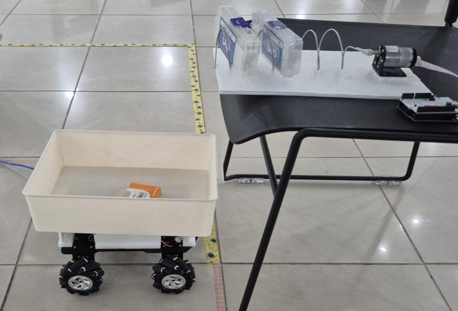
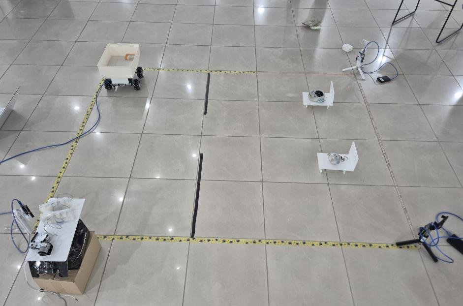
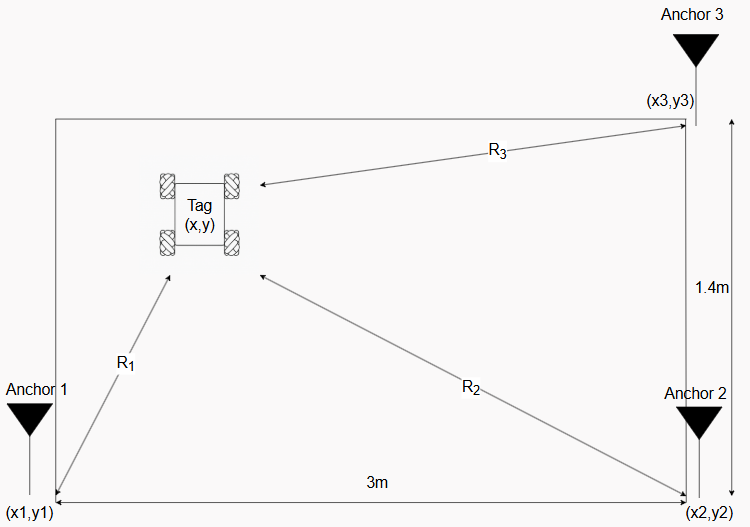

# UWB-based Indoor Autonomous Medicine Delivery Vehicle

> Capstone Design · 2025.03 – 2025.06 · 4-person team

An indoor delivery vehicle for hospital-like environments where GPS is unavailable. The vehicle position is estimated from UWB (DW1000) ranging to three fixed anchors, and the vehicle drives from a medicine dispenser to the target room.

  
  
   Left: mecanum-wheel vehicle and medicine dispenser · Right: indoor test field

---

## System Architecture

---

## Localization Pipeline

### 1. Ranging: TWR (Two-Way Ranging)
- Tag (vehicle) and each anchor exchange UWB messages; the distance is computed from the round-trip time of flight.

### 2. Positioning: Trilateration
- The (x, y) position of the tag is computed from the ranges R1, R2, R3 to three anchors at known positions.

  
   Anchor layout and trilateration (test field 3 m × 1.4 m)

### 3. Filtering: EKF + Innovation Gating
- Under NLOS (Non-Line-of-Sight) conditions, range errors are biased in the positive (+) direction.
- Measurements whose innovation (measurement − prediction) exceeds the gate are rejected before the EKF update.
- Result: path tracking RMSE improved by about **24.2%**.

---

## Hardware

- Controller: Arduino Nano / ESP8266
- Ranging: DW1000 UWB module (SPI)
- Drive: mecanum wheels, DC motors and motor driver (L298N)

---

## Repository Structure

| Path | Description |
|---|---|
| `libs/DW1000-jang` | DW1000 library used in the project |
| `docs/` | Slides, poster (PDF), images |
| `media/` | Demo videos |
